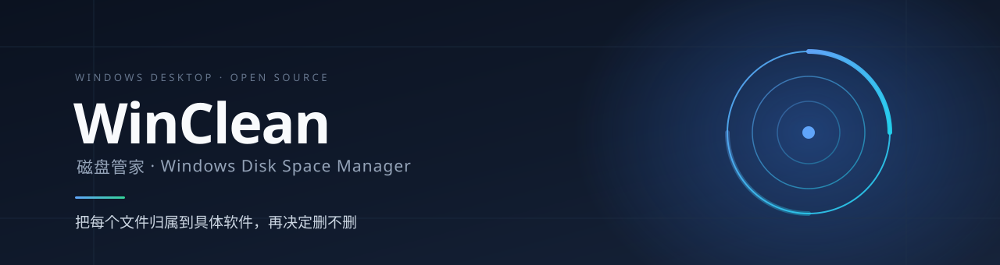
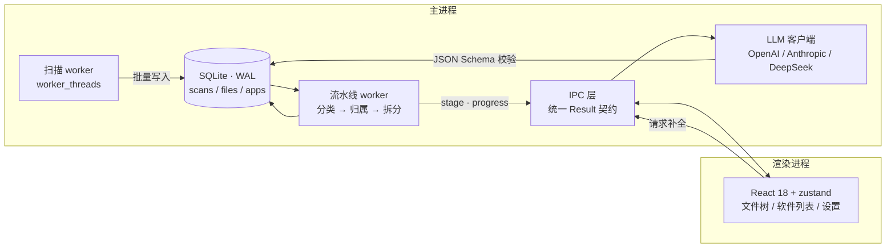

<div align="center">



**Windows 磁盘空间管家** —— 不只告诉你「哪个文件夹最大」，而是告诉你「这些文件属于哪个软件、哪些能删」。


[下载](#下载安装) · [功能](#功能) · [架构](#架构) · [性能](#性能) · [隐私与安全](#隐私与安全) · [文档](#文档)

</div>

---

## 它解决什么问题

Windows 上的清理工具大多只做一件事：按目录大小排序。可你盯着 `C:\Users\你\AppData\Local\Packages\Microsoft.Windows.Photos_8wekyb3d8bbwe` 看半天，还是不知道它属于哪个软件、删了会怎样。

WinClean 换了个方向：

1. **先归属** —— 把全盘上百万个文件映射到具体的已安装软件（注册表、UWP、服务、App Paths + 六条匹配规则）。
2. **再拆分** —— 每个软件的占用拆成「本体 / 必要缓存 / 非必要缓存」三段，只有后两段才可能进清理计划。
3. **最后解释** —— 规则拿不准的，交给大模型补全归属、用一句话说清这堆文件是干什么的。

删除不是「选中—删除」，而是「生成计划 → 逐项校验 → 预览确认 → 执行 → 记日志」。

## 功能

| 模块 | 能力 |
| :--- | :--- |
| **扫描** | 全盘或指定盘、`worker_threads` 并行、随时取消、跳过符号链接与 junction、单个文件报错不中断并记入 `scan_errors` |
| **分类** | 系统 / 用户 / 未归属三类，按路径与注册表信息判定 |
| **归属** | 注册表卸载项、UWP 包、服务、App Paths 四路采集，配合 R1~R6 规则匹配，含歧义处理（如 Adobe 与 Adobe Acrobat） |
| **拆分** | 软件占用三段拆分，输出可直接驱动清理计划的目录项 |
| **清理** | 计划预览（路径 / 大小 / 分类 / 风险 / 理由 / 预计释放量）、默认回收站、永久删除需显式开启、全程写入 `clean_log` |
| **AI 补全** | 未归属目录简述、归属补全；批量请求 + 截断自动二分重试 + JSON Schema 校验 |
| **界面** | React Flow 文件关系树、懒加载、未归属虚拟列表、深浅色主题、三页导航 |

<details>
<summary><b>六条归属规则（点击展开）</b></summary>

| 规则 | 依据 | 置信度 |
| :--- | :--- | :--- |
| **R1** | 落在软件安装目录内 | 0.98 |
| **R2** | 落在软件可执行文件所在目录内 | 0.95 |
| **R3** | `%LOCALAPPDATA%` / `%APPDATA%` / `%PROGRAMDATA%` 下的名称或发布者匹配 | 按命中强度递减 |
| **R4** | UWP 包目录匹配 | 高 |
| **R5** | `%TEMP%` 下按名称匹配 | 中 |
| **R6** | 注册表卸载项一级键匹配 | 1.0 |

命中多个规则时取置信度最高者；置信度接近时标记为歧义并交由 AI 或人工确认。

</details>

## 架构



**关键约束**

- 渲染进程**永不**直接接触文件系统，全部能力经 `contextBridge` 暴露的 `window.api`。
- 所有 IPC 返回统一为 `Result<T> = { ok: true, data } | { ok: false, error }`，错误带 `detail` 透传上游原文。
- 扫描与流水线都在独立 worker 中运行，主线程只负责转发事件，避免同步写库阻塞 UI。

<details>
<summary><b>技术栈（点击展开）</b></summary>

| 层 | 选型 |
| :--- | :--- |
| 运行时 | Electron 45 · Node ≥ 22.12 |
| 构建 | electron-vite 6 · Vite 8 · electron-builder 26（NSIS x64） |
| 界面 | React 18 · React Router 7 · zustand 5 · @xyflow/react 12 · @tanstack/react-virtual |
| 数据 | better-sqlite3 13（N-API 预编译，无需 rebuild）· zod 4 |
| 质量 | TypeScript 5.9（`strict`）· ESLint 10 · Prettier 3 · Vitest 5 |

</details>

## 性能

一次全盘扫描后的后处理阶段实测（Windows 11 / 开发机）：

| 阶段 | 规模 | 耗时 |
| :--- | ---: | ---: |
| 分类 | 466,260 行 | 11.3 s |
| 归属 | 466,260 行 | 17.8 s |
| 三段拆分 | 48,849 项 | 6.3 s |
| 流水线总计（含注册表采集与 WAL 检查点） | — | **65.5 s** |
| AI 归属补全 | 8 项 / 批 | 5 – 20 s / 批（首批含冷启动） |

归属写回使用 `path` 索引的范围更新而非逐条前缀扫描，单批从 2842 ms 降到 1165 ms。

## 下载安装

从 [Releases](https://github.com/HERZAy1/WinClean/releases) 下载：

| 文件 | 大小 | 说明 |
| :--- | ---: | :--- |
| `WinClean-0.1.0-Setup.exe` | 117.5 MB | 安装版，写入 `C:\Program Files\WinClean` |
| `WinClean-0.1.0-Portable.zip` | 165.4 MB | 免安装版，完整解压后双击 `WinClean.exe` |

> 安装包未做代码签名，SmartScreen 可能提示「未知发布者」，选择「更多信息 → 仍要运行」。
> 两个版本共用 `%APPDATA%\winclean` 下的数据库与配置。

## 开发

```bash
# 环境要求：Node ≥ 22.12，Windows 10 1809+
npm install
npm run dev
```

| 命令 | 作用 |
| :--- | :--- |
| `npm run dev` | 启动开发模式（HMR） |
| `npm run typecheck` | `tsc --noEmit` |
| `npm test` | Vitest 全量测试 |
| `npm run lint` | ESLint，零警告 |
| `npm run build` | 构建到 `out/` |
| `npm run package` | 构建并打包 NSIS 安装包到 `dist/` |
| `npm run package:dir` | 只生成免安装目录 `dist/win-unpacked/` |

<details>
<summary><b>打包与原生模块说明（点击展开）</b></summary>

- `better-sqlite3` 使用 N-API 预编译产物，通常无需重编译；确有需要时运行 `npm run rebuild`。
- `out/main/scan-worker.js` 与 `out/main/pipeline-worker.js` 通过 `asarUnpack` 解包到 `app.asar.unpacked`，worker 才能被加载。
- 发行版启动时关闭 Chromium 沙箱：安装包清单要求 `requireAdministrator`，在提升进程中 Chromium 沙箱无法创建 GPU / 渲染子进程，会导致启动即崩（`0x80000003`）。

</details>

## 隐私与安全

> 删除与隐私的完整红线见 [docs/SAFETY.md](docs/SAFETY.md)。

**隐私**

- 发送给 LLM 的只有：脱敏路径（用户名替换为 `%USERNAME%`）、名称、大小、扩展名分布、候选软件名。
- **绝不发送文件内容。**
- 首次分析前弹窗说明并取得同意，同意状态可在设置中撤销。
- API Key 仅在主进程经 `safeStorage` 加密保存，渲染进程只能得到 `hasApiKey`；日志中不打印 Key。

**删除**

- `clean:execute` 只接受 `clean:preview` 生成的 `planId`，主进程自行从计划表取路径，不接受渲染进程传入路径。
- 默认进回收站；永久删除需在设置中显式开启并二次确认。
- 硬拦截 `Windows`、`$Recycle.Bin`、`System Volume Information`、`Recovery`、`Boot`、`EFI`、`pagefile.sys` 等，以及用户个人库根目录。
- 软件本体永不可删；必要缓存默认不勾选；LLM 结论必须再通过本地范围校验才能进入计划。

## 项目结构

```text
src/
├─ main/            Electron 主进程
│  ├─ scan/         全盘扫描 worker
│  ├─ pipeline/     分类 → 归属 → 拆分 流水线 worker
│  ├─ registry/     注册表 / UWP / 服务 / App Paths 采集
│  ├─ ownership/    R1~R6 归属规则与写回
│  ├─ breakdown/    三段拆分
│  ├─ analysis/     AI 归属补全（批量、重试、进度）
│  ├─ clean/        清理计划、执行、日志
│  ├─ safety/       路径校验与硬拦截
│  ├─ llm/          OpenAI / Anthropic / DeepSeek 客户端
│  └─ ipc/          通道注册与参数校验
├─ preload/         contextBridge API
├─ renderer/        React 页面、组件、主题
└─ shared/          契约类型与 IPC 通道常量
```

## 测试

```bash
npm test        # 35 个测试文件，325 个用例
npm run lint    # ESLint 零警告
npm run typecheck
```

覆盖重点：归属规则（含歧义与优先级）、路径安全拦截、LLM 响应校验与截断重试、进度事件分流、清理计划生成。

## 文档

| 文档 | 内容 |
| :--- | :--- |
| [docs/CONTRACT.md](docs/CONTRACT.md) | 数据模型、IPC 契约、SQLite 表结构 |
| [docs/SAFETY.md](docs/SAFETY.md) | 删除与隐私红线（实现必须遵守） |
| [docs/QA.md](docs/QA.md) | 验收清单与性能基线 |

## 已知限制

- 需要管理员权限才能读取部分系统目录，因此安装包请求提升；代价是 Chromium 沙箱被关闭（应用只加载本地打包页面，所有远程请求在主进程发起）。
- 自动化测试未覆盖真实付费 LLM API、真实 C 盘全量扫描、真实回收站恢复，需在普通 Windows 桌面或虚拟机复验。
- LLM 对 >50 MB 未命中目录的复核尚未接入实际调用，当前走规则分类 + 本地安全降级。
- 安装包未签名。

## 贡献

欢迎 Issue 与 PR。提交前请确保：

```bash
npm run typecheck && npm run lint && npm test
```

涉及删除逻辑的改动，请先读 [docs/SAFETY.md](docs/SAFETY.md)，红线不可协商。

---

<div align="center">

如果这个项目对你有帮助，点个 Star ⭐ 是最好的鼓励。

</div>
